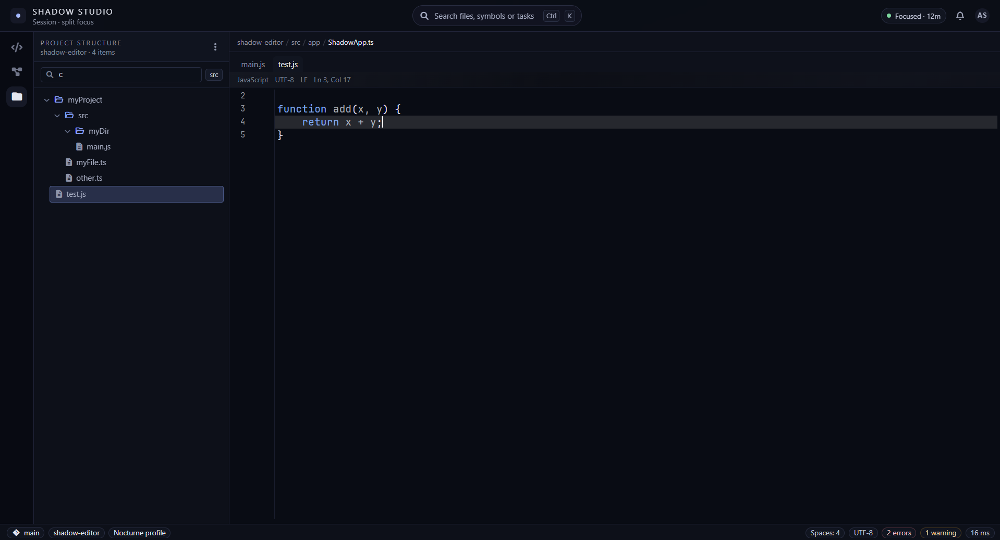
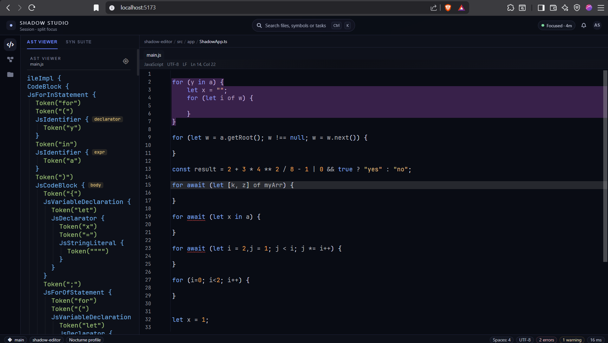
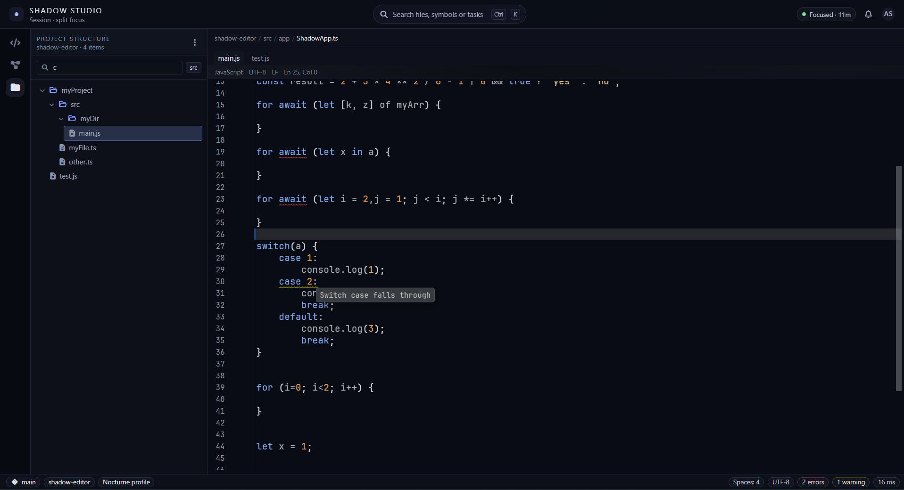

[](https://opensource.org/licenses/Apache-2.0)

# Shadow Editor

A complete editor written from scratch in TypeScript supporting text highlighting, AST parsers, and more.

<p align="center">
  
</p>

This file aims at providing with the basic functionality
and installation features. In case you are interested by plugin development, you can check
out [DOCUMENTATION.md](/docs/DOCUMENTATION.md).  
<br>
> [!NOTE]
> This project is still under developpment and hence doesn't provide a release bundle. The only way to use this project
> for now is to download the source code directly.

***

## Features

### AST Viewer

Shadow Editor ships with a built-in AST viewer, letting you inspect the parse tree of any open document in real time alongside the editor.

<p align="center">
  
</p>

### Inspections

The editor continuously analyses your code and surfaces diagnostics inline — warnings, errors, and hints appear directly at the relevant location without interrupting your flow.

<p align="center">
  
</p>

***

## Installation

### Prerequisites

- Node.js (v18 or higher recommended)
- npm or yarn

### Setup

1. Clone the repository:
   ```bash
   git clone https://github.com/your-username/shadow-editor.git
   cd shadow-editor
   ```

2. Install dependencies:
   ```bash
   npm install
   ```

3. Start the development server:
   ```bash
   npm run dev
   ```

4. Open your browser and navigate to `http://localhost:5173` (or the URL shown in the terminal)

## Basic Usage

### Launching the application

The ShadowEditor can be launched in two distinct modes: FullUI and EditorOnly. The first one provides with a complete
user interface, while the second one only renders the editor component, allowing you to integrate it into your own
application.
In any case, the `ShadowApp` class must be running as it manages the lifecycle of the application. Here is how to launch
the app in both modes:

```typescript
import {ShadowUIFactory} from "./src/app/ui/ShadowUIFactory";
import {ShadowApp} from "./src/app/ShadowApp";

const app = await ShadowApp.launch(true); // true if you want to show the progress bar as the app is loading, false otherwise

if (!app) {
    console.error("Failed to launch the Shadow Editor application.");
} else {
    console.log("Shadow Editor application launched successfully.");

    // FullUI mode
    ui = await ShadowUIFactory.fullAppUI();

    // EditorOnly mode
    ui = await ShadowUIFactory.singleEditorUI();
}
```

### Plugins

The Shadow Editor is extremely configurable by using Plugins. Plugins can be used for a wide variety of purposes, such
as adding support for new languages, providing with new actions, or even modifying the user interface. You can check
out [DOCUMENTATION.md](/docs/DOCUMENTATION.md) for more details about plugin development. However, here
are some examples of how to use plugins in your application:

### Enabling

Plugins are automatically loaded from the `src.plugins` directory. However, plugins are always loaded in disabled mode.
To enable a plugin, you have to use explicitly tell the app to do so. For instance, to enable javascript support:

```typescript
import JSLangPlugin from "./src/plugins/jsLang/JSLangPlugin"; // exported default


app.enable(JSLangPlugin.class); // The `class` property of a plugin is a special variable holding a reference to the plugin class itself, which is singleton. 
```

### Events

The editor is constantly broadcasting events about its state. You can listen to these events by using
the `EventBus` class. For instance, to listen to document changes:

```typescript
const bus = GlobalState.getMainEventBus(); // GlobalState is a special class that holds references
                                           // to the most important components of the app, such as the main event bus

bus.subscribe(this, DocumentModificationEvent.SUBSCRIBER, (event: DocumentModificationEvent) => {
    // Do something when the document is modified
});

```

### Actions and contextual data

Actions extend `AbstractAction` and receive a `KeybindContext` when they run. The
context contains the trigger event and typed contextual data. Use
`CommonDataKeys` instead of relying on closures or manually constructing
editor/pane state:

```typescript
import {AbstractAction} from "./src/core/actions/AbstractAction";
import {CommonDataKeys} from "./src/core/keybinds/context/data/CommonDataKeys";
import {Keybind} from "./src/core/keybinds/Keybind";
import {KeybindContext} from "./src/core/keybinds/context/KeybindContext";

export class OpenFileAction extends AbstractAction {
    getName(): string {
        return "Open File";
    }

    getDescription(): string {
        return "Open the file selected in the project tree.";
    }

    getDefaultKeybinding(): Keybind | null {
        return null;
    }

    getRequiredKeys() {
        return [CommonDataKeys.PROJECT_FILE];
    }

    run(ctx: KeybindContext): void {
        const file = ctx.require(CommonDataKeys.PROJECT_FILE);
        // Use file.getURI(), navigate to it, or perform another file action.
    }
}
```

`getRequiredKeys()` is used by keybinds and menus to determine whether an
action is applicable. `ctx.require(key)` is typed and throws the normal
not-applicable error when a required value is missing. For editor actions, the
built-in keys include `EDITOR`, `PANE`, `PROJECT_FILE`, `PROJECT_FILES`, and
`TEXT_AREA`. Legacy `requireEditor()`, `requirePane()`, and
`getKeybindContext()` remain available while existing actions are migrated.

Menus can use registered actions directly. Context-menu data is captured when
the menu opens, so the action receives the file or editor that initiated the
menu even if focus changes before the item is clicked:

```typescript
contextMenu.addAction("Open", new OpenFileAction());
```

For small one-off operations, the callback form is still supported and
receives the same context:

```typescript
contextMenu.addAction("Delete", ctx => {
    const file = ctx?.require(CommonDataKeys.PROJECT_FILE);
    file?.delete();
});
```

Related actions can be placed in an `ActionGroup` and added to a menu with
`setGroup()`:

```typescript
contextMenu.setGroup(projectActions);
```

Only active group actions are added, and their applicability is evaluated
against the menu's captured context.

## Acknowledgments

Although the code for this project was entirely written by me, some of its core concepts are inspired by those
of [JetBrains intellij-community](https://github.com/JetBrains/intellij-community) *(logical/visual position,
ASTBuilder, Actions, etc...)*. Moreover, the design of the UI draws a lot of inspiration from their editors.

This project also uses [JetBrains Mono](https://www.jetbrains.com/lp/mono/), licensed under
the [Apache 2.0 License](https://www.apache.org/licenses/LICENSE-2.0).