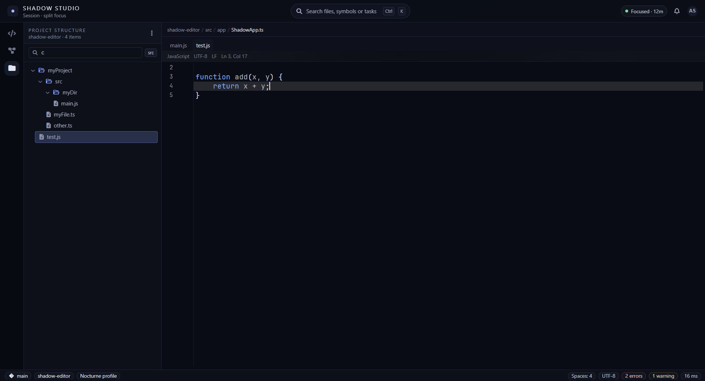
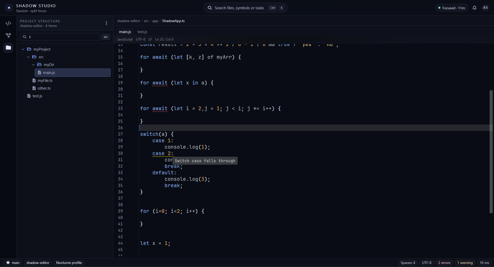
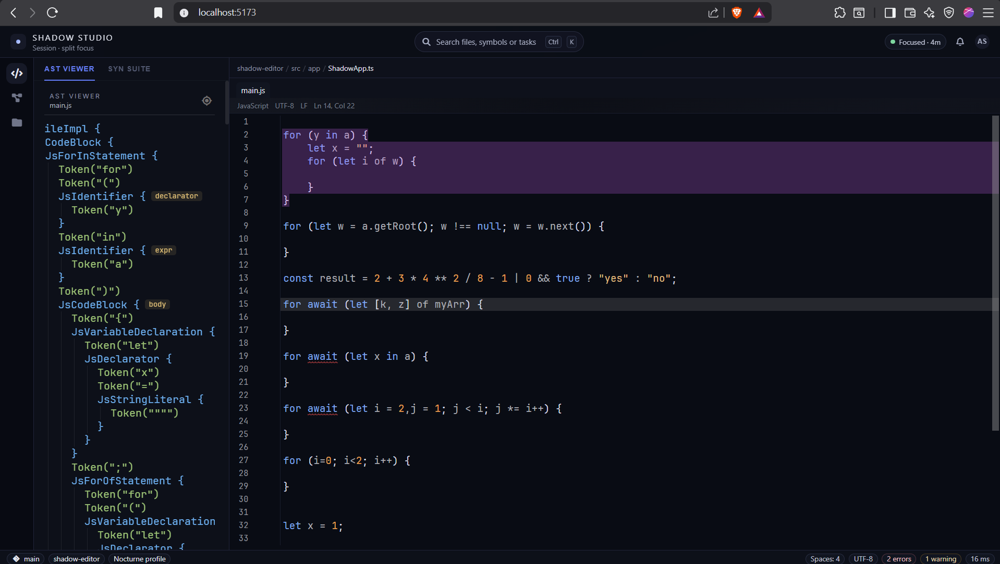

[](https://opensource.org/licenses/Apache-2.0)

# Shadow Editor

A browser-based code editor and IDE shell written from scratch in TypeScript. It has no runtime framework: the
text view, the incremental lexers and parsers, the code analysis pipeline, the UI toolkit and the plugin system are
all part of this repository.

<p align="center">
  
</p>

This file covers what the editor does and how to run it. If you want to extend it (add a language, an inspection, a
pane, an action...), read [DOCUMENTATION.md](./docs/DOCUMENTATION.md).

> [!NOTE]
> This project is still under development and doesn't provide a release bundle. The only way to use it for now is to
> run it from source.

***

## Features

### Editing

- Custom text view with gutter, scrollbars, selection, clipboard and grouped undo/redo
- Incremental lexing and parsing: only the part of the document affected by an edit is re-lexed and re-parsed
- Syntax highlighting, plus semantic highlighting from annotators that run on the syntax tree
- Smart typing: auto-closing brackets and quotes, skipping over a closing character, smart Enter and Backspace
- Code completion (`Ctrl+Space`, or as you type)
- Context actions (`Alt+Enter`): intents such as "Swap operands" or "Convert `for…of` into an indexed `for`", and
  quick fixes for inspection problems
- Code formatting for JavaScript (`Ctrl+Alt+L`)
- Read-only editors and a side-by-side diff view

### Languages

Language support comes from plugins. Three are bundled:

| Plugin              | Language        | What it provides                                                                                      |
|:--------------------|:----------------|:------------------------------------------------------------------------------------------------------|
| `jsLang`            | JavaScript      | Lexer, parser, highlighting, annotators, inspections, intents, completion, smart typing, code style   |
| `htmlLang`          | HTML            | Lexer, parser, highlighting, inspections, smart typing (tag auto-close)                               |
| `riscvAssemblyLang` | RISC-V assembly | Lexer, parser, highlighting, label annotator, control-flow analysis and inspections                   |

### Inspections

The editor analyses your code as you type and reports problems inline, at the location they apply to.

<p align="center">
  
</p>

### IDE shell

- Projects stored in the browser, with a project file tree (create, rename, delete)
- Editor tabs and breadcrumbs; open tabs, caret and scroll positions are restored when you reload
- Automatic saving
- Search Everywhere across the project files (`Ctrl+Shift+F`)
- Dockable panes, a settings dialog, context menus and a dialog system

### Debug tools

The bundled `debugTools` plugin adds tooling for working on the editor itself:

- **AST viewer**: a pane showing the syntax tree of the open document, updated as you type and following the caret
- **Debug tools popup** (`Ctrl+Alt+,`): AST and code style inspectors
- **SynSuite** (`Ctrl+Shift+Alt+T`): a snapshot test suite for parsers and inspections. `Ctrl+Alt+T` snapshots the
  current document as a new test

<p align="center">
  
</p>

***

## Getting started

### Prerequisites

- Node.js 20.19+ or 22.12+ (required by Vite 8)
- npm
- A browser that supports the Origin Private File System, IndexedDB and module web workers. Development is done on
  Chromium-based browsers.

### Setup

1. Clone the repository:
   ```bash
   git clone https://github.com/atzitz-amos/shadow-editor.git
   cd shadow-editor
   ```

2. Install dependencies:
   ```bash
   npm install
   ```

3. Start the development server:
   ```bash
   npm run dev
   ```

4. Open `http://localhost:5173/shadow-editor/dist/` in your browser.

> [!IMPORTANT]
> The app is served under the `/shadow-editor/dist/` base path (see `base` in [vite.config.ts](./vite.config.ts)),
> not at the server root. `http://localhost:5173/` alone will not load it.

### Other scripts

| Command           | What it does                                           |
|:------------------|:-------------------------------------------------------|
| `npm run dev`     | Starts the Vite development server                     |
| `npm run build`   | Builds the app into `dist/`                            |
| `npm run preview` | Serves the content of `dist/` locally                  |

`dist/` is committed to the repository, so a production build can be served from any static host under the
`/shadow-editor/dist/` path.

### Where your data lives

Everything is stored in the browser, per origin:

- Project files are written to the Origin Private File System
- Settings, open tabs, workspaces and other state are written to an IndexedDB database named `shadow.db`

Nothing is sent to a server. Clearing the site data of the origin deletes your projects.

***

## Keyboard shortcuts

These are the default bindings.

| Shortcut                    | Action                                              |
|:----------------------------|:----------------------------------------------------|
| `Ctrl+Space`                | Open code completion                                |
| `Alt+Enter`                 | Open context actions (intents and quick fixes)      |
| `Ctrl+Alt+L`                | Reformat code (JavaScript)                          |
| `Ctrl+Numpad /`             | Comment or uncomment the selected lines (JavaScript) |
| `Ctrl+Z` / `Ctrl+Shift+Z`   | Undo / redo                                         |
| `Ctrl+C` / `Ctrl+X` / `Ctrl+V` | Copy / cut / paste                               |
| `Ctrl+A`                    | Select all                                          |
| `Ctrl+Y`                    | Delete the current line                             |
| `Tab` / `Shift+Tab`         | Indent / dedent                                     |
| `Ctrl+←` / `Ctrl+→`         | Move the caret by word                              |
| `Ctrl+Backspace`            | Delete the word before the caret                    |
| `Ctrl+Shift+F`              | Search Everywhere                                   |
| `Ctrl+Alt+S`                | Open settings                                       |
| `Ctrl+F4`                   | Close the current tab (some browsers reserve this key) |
| `Alt+Insert`                | New file or directory (project tree)                |
| `Shift+F6`                  | Rename the selected entry (project tree)            |
| `Delete`                    | Delete the selected entry (project tree)            |
| `Ctrl+Alt+,`                | Toggle the debug tools popup                        |
| `Ctrl+Shift+Alt+T`          | Open the SynSuite window                            |
| `Ctrl+Alt+T`                | Snapshot the current document as a SynSuite test    |

***

## Using the editor in your own page

`ShadowApp` owns the application lifecycle and must be launched before anything else. Once it is running, open a
project, create the UI and enable the plugins you need:

```typescript
import {ShadowApp} from "./src/app/ShadowApp";
import {ShadowUIFactory} from "./src/app/ui/ShadowUIFactory";
import {Project} from "./src/core/project/Project";
import JSLangPlugin from "./src/plugins/jsLang/JSLangPlugin";

// `true` shows the splash screen and progress bar while the app is loading
const app = await ShadowApp.launch(true);

if (!app) {
    console.error("Failed to launch the Shadow Editor application.");
} else {
    app.openProject(new Project("myProject"));

    const ui = await ShadowUIFactory.fullAppUI();

    // Plugins are discovered automatically but start disabled
    app.enable(JSLangPlugin.class);

    const editor = ui.getMainEditor();
}
```

`ShadowApp.launch()` resolves to `undefined` if a critical startup phase failed. [index.html](./index.html) is the
entry point used by the development server and shows a complete setup.

> [!NOTE]
> `ShadowUIFactory.singleEditorUI()`, meant to render a single editor without the IDE shell, is not implemented yet.
> `fullAppUI()` is the only working mode.

### Plugins

Plugins are loaded from `src/plugins`: each directory is a plugin, and each subdirectory contributes to an extension
point. They are always loaded disabled, so you have to enable the ones you want:

```typescript
import DebugToolsPlugin from "./src/plugins/debugTools/DebugToolsPlugin";

app.enable(DebugToolsPlugin.class); // `class` refers to the plugin class itself
```

### Events

The app broadcasts what happens on an `EventBus`. Every event class exposes a `SUBSCRIBER` to subscribe with:

```typescript
import {GlobalState} from "./src/core/global/GlobalState";
import {DocumentModificationEvent} from "./src/editor/core/document/events/DocumentModificationEvent";

GlobalState.getMainEventBus().subscribe(this, DocumentModificationEvent.SUBSCRIBER, event => {
    console.log("Inserted:", event.getInsertedText());
});
```

Writing plugins, actions, inspections and the rest of the API is covered in
[DOCUMENTATION.md](./docs/DOCUMENTATION.md).

***

## Repository layout

| Path           | Content                                                                                           |
|:---------------|:--------------------------------------------------------------------------------------------------|
| `src/core`     | Infrastructure: lifecycle, events, plugins, actions and keybinds, persistence, settings, projects and file system, web workers, UI toolkit |
| `src/editor`   | The editor component: document model, caret, view, highlighting, popups, undo, completion UI      |
| `src/lang`     | Language framework: lexers, parsers, syntax trees, code analysis, completion, code generation, code style |
| `src/app`      | The IDE shell: `ShadowApp`, layout, panes, tabs, settings, search, the SynSuite engine            |
| `src/plugins`  | Bundled plugins: `jsLang`, `htmlLang`, `riscvAssemblyLang`, `debugTools`                          |
| `res`          | Editor stylesheets, fonts and images                                                              |
| `docs`         | Documentation and screenshots                                                                     |
| `tests`        | Standalone experiments and manual test pages                                                      |
| `dist`         | Production build output                                                                           |

## Acknowledgments

Although the code for this project was entirely written by me, some of its core concepts are inspired by those
of [JetBrains intellij-community](https://github.com/JetBrains/intellij-community) *(logical/visual position,
ASTBuilder, Actions, etc...)*. Moreover, the design of the UI draws a lot of inspiration from their editors.

This project also uses [JetBrains Mono](https://www.jetbrains.com/lp/mono/), licensed under
the [Apache 2.0 License](https://www.apache.org/licenses/LICENSE-2.0).

## License

Shadow Editor is licensed under the [Apache License 2.0](./LICENSE).
